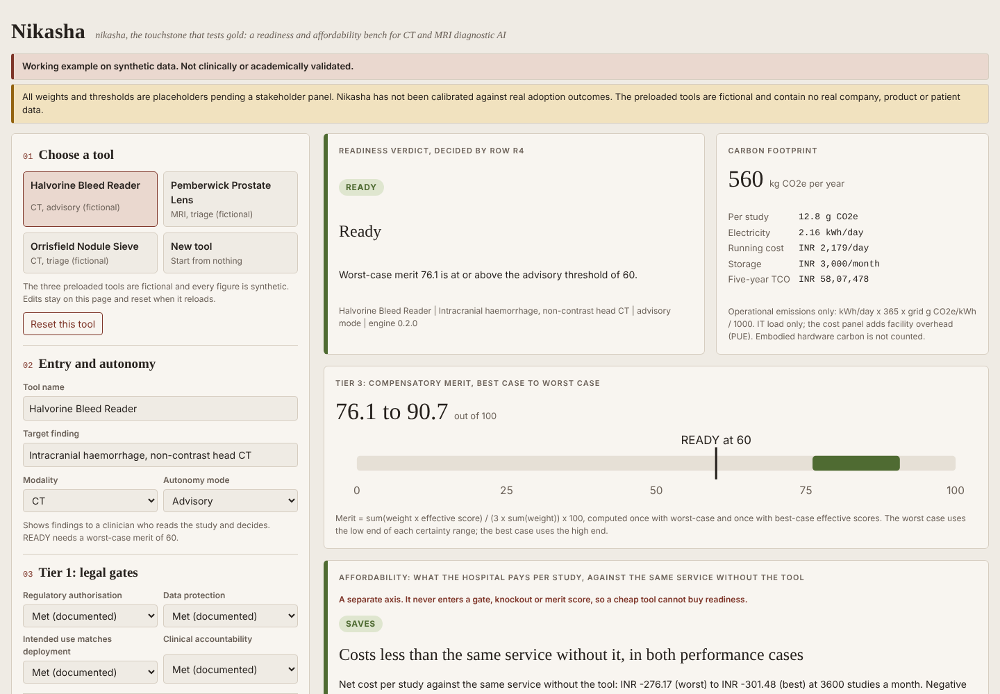
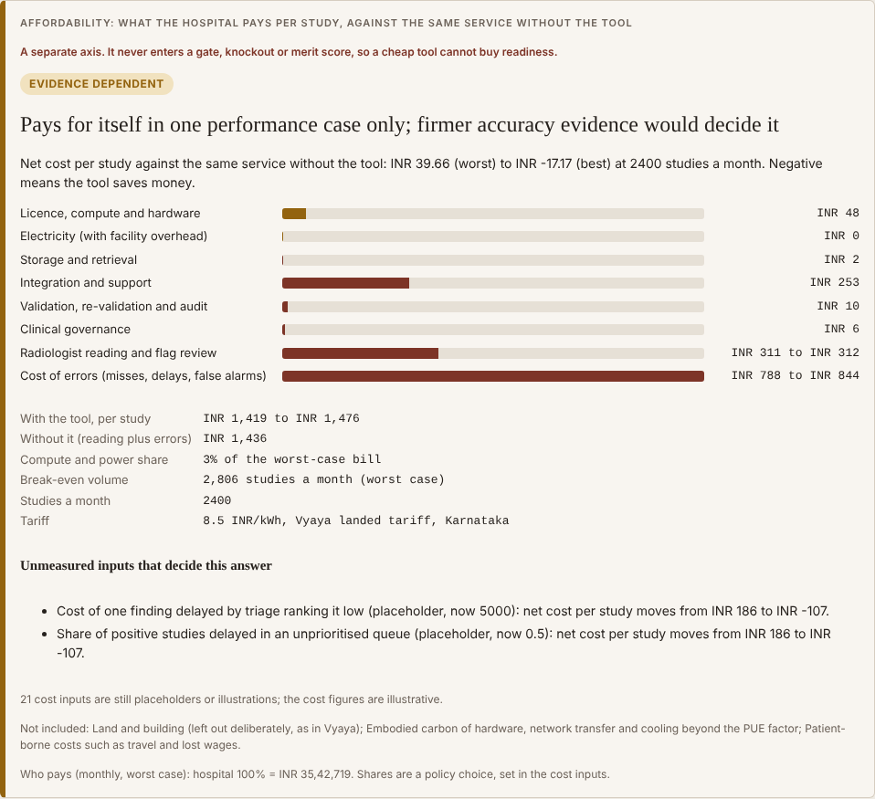

# Nikasha

*Nikasha (Sanskrit nikaṣa, the touchstone used to test gold) asks two questions of a clinical AI tool: is it ready to enter practice, and can anyone afford to run it?*

> **Status: working example on synthetic data, for illustration only.** The code, the sample tools and every run shown here are synthetic. Nothing in this repository is clinically or academically validated. All weights, thresholds and most cost inputs are placeholders pending a stakeholder panel, and the framework has not been calibrated against real adoption outcomes. The three sample tools are fictional; no real company, product or patient data appears anywhere. Do not use a result from this repository to make a clinical, procurement or funding decision.

## What it does

A hospital that is offered a CT or MRI AI tool has to answer two different questions, and they should never be traded against each other.

The first question is readiness. Nikasha checks that the tool is in scope (CT or MRI only), that it clears the legal gates, and that its miss rate and false-alarm rate clear safety floors that rise with how much the tool is allowed to do on its own. Only then does it weigh the remaining strengths and weaknesses, discounted by how good the evidence for each claim is.

The second question is affordability. Nikasha builds a per-study cost profile with the cost layers that usually dwarf compute: radiologist time, the cost of the errors the tool and the reader still make, validation on local data, integration and governance. It compares that with the same service without the tool and reports the volume at which the tool pays for itself.

Affordability is reported on its own axis and never enters a gate, a knockout or the merit score. A cheap tool cannot buy readiness, and a safe tool is not called affordable just because it is safe.

The cost side comes from [Vyaya](https://github.com/agravaaniresearch/vyaya), the transparent AI cost calculator for Indian hospitals. Nikasha vendors Vyaya's engine and data at a pinned commit and reads its state-wise landed electricity tariffs, its statutory hardware life, its GPU failure rate and its facility overhead from there, so each shared figure is held once.

The premise is simple: a method that works under Indian constraints, where compute, power, radiologist time and validation budgets are all scarce, can be carried anywhere. Every Indian figure in Nikasha is data, not code, and can be replaced for another health system.

## Open it

Download `index.html` and open it in any modern browser. Once GitHub Pages is switched on for this repository (Settings, Pages, deploy from the `main` branch, root folder), the same page is published at **https://agravaaniresearch.github.io/nikasha/**. It is one self-contained file: no server, no install, no network calls and no fonts or scripts from elsewhere, so it also works offline and survives being emailed. Nothing you type leaves your device.

The left side is the pipeline: choose a sample tool or start blank, set its gates, parameters, infrastructure, accuracy and cost inputs. The right side is the live record: the readiness verdict, the merit band, the affordability panel with every cost layer, the inputs that decide the answer, and the full evaluation as JSON.



## What runs, and why

Readiness runs in four ordered steps. The first step to fail decides the verdict, and later steps are still shown for transparency.

1. **Entry.** Only CT and MRI tools are scored, because the error anchors are written for cross-sectional reads. X-ray and mammography are rejected with the reason shown.
2. **Tier 1, legal gates.** Regulatory authorisation, data protection, intended use matching the deployment mode, and a named clinical owner. Autonomous use adds a gate for unsupervised reporting. A gate that is unknown or left out counts as not met.
3. **Tier 2, clinical knockouts.** Sensitivity and specificity in every mode, external validation from triage upwards, and post-deployment monitoring for autonomous use. Each compares the worst-case evidence-discounted score with a minimum that rises with autonomy.
4. **Tier 3, merit.** Fifteen parameters, each scored 0 to 3 against written anchors and discounted by an evidence certainty table (clinical use highest, unsupported claims zero), are weighted by one of four autonomy profiles. Merit is a worst-case to best-case band, and an explicit decision table turns it into Ready, Conditional or Not ready.

Affordability runs in parallel through the cost bridge (`src/cost.js`).

1. It resolves every cost input: the tool's own value if given, otherwise the default with its provenance status (statutory, secondary, placeholder, illustrative or user).
2. It builds eight cost layers per study: licence, compute and hardware (with Vyaya's capital recovery and expected hardware failure cost); electricity with facility overhead at the state's landed tariff; storage; integration and support; validation, re-validation and audit; governance; radiologist reading and flag review; and the cost of misses, delays and false alarms.
3. It runs the layers twice, once with the lower 95% confidence bounds of sensitivity and specificity and once with the point estimates, and compares each with the same service without the tool.
4. It reports the affordability verdict, the break-even volume, who pays, what is not included, and a driver analysis that halves and raises by half every placeholder input to find the ones that decide the answer.

The cost profile it produces is a documented contract (`schema/cost-profile.schema.json`). Vyaya can produce the same document, and a profile made elsewhere can be supplied to Nikasha ready-made.

## An example run on synthetic data

`npm run demo` scores the three fictional sample tools. This is the start of its output for the first one.

```
Halvorine Bleed Reader (CT, advisory mode): READY.
  Why: Worst-case merit 76.1 is at or above the advisory threshold of 60.
  Affordability (separate axis, does not change readiness): Costs less than the same service without it, in both performance cases.
    Cost per study with the tool INR 311 (best) to 336 (worst), against INR 612 for the same service without it (reading plus errors).
    Compute and power are 8% of the worst-case bill; reading time is 62%.
  Cost layers per study (worst case), 3600 studies a month, tariff 9 INR/kWh from Vyaya national working default (no figure for Punjab):
    Licence, compute and hardware                   INR 26
    Electricity (with facility overhead)            INR 0
    Storage and retrieval                           INR 1
    Integration and support                         INR 8
    Validation, re-validation and audit             INR 9
    Clinical governance                             INR 4
    Radiologist reading and flag review             INR 208
    Cost of errors (misses, delays, false alarms)   INR 81
  Break-even volume: 286 studies a month (worst case)
  Unmeasured inputs that decide the affordability verdict: Radiologist sensitivity reading without the tool (placeholder).
  Warning: No verified landed tariff for Punjab in Vyaya yet; the national working default of INR 9/kWh (placeholder) was used.
```

All three samples, in summary (every figure synthetic):

| Fictional tool | Modality, mode | Readiness | Affordability | Cost per study with tool | Without it | Compute and power share | Decided by |
|---|---|---|---|---|---|---|---|
| Halvorine Bleed Reader | CT, advisory | Ready (merit 76.1 to 90.7, bar 60) | Saves | INR 311 to 336 | INR 612 | 8% | Reader sensitivity |
| Pemberwick Prostate Lens | MRI, triage | Not ready: sensitivity rests on a brochure | Saves | INR 2,424 to 2,552 | INR 2,759 | 11% | Cost and share of delayed findings |
| Orrisfield Nodule Sieve | CT, triage | Conditional (merit 49.8 to 69.0, bar 68) | Evidence-dependent | INR 1,419 to 1,476 | INR 1,436 | 3% | Cost and share of delayed findings |

What the example shows, read as illustration and not as findings:

- **Compute is the small line.** Compute and power are 3% to 11% of the bill in all three samples, while reading time and errors are most of it. This is the pattern Vyaya found for document extraction, and it holds here for imaging.
- **Affordable is not ready.** Pemberwick saves money on these inputs and is still not ready, because its sensitivity claim rests on a vendor brochure. The two axes are kept apart on purpose.
- **Open source moves cost; it does not remove it.** Orrisfield is open source, so it carries no licence fee, but the site runs it with its own engineering team. Its affordability then depends on the accuracy evidence, as its readiness does.
- **The deciding numbers are the ones nobody has published.** In each case the verdict turns on a placeholder, such as how good the radiologists already are or what a delayed finding costs. The driver analysis names which number a site should measure first.
- **Data gaps show themselves.** Punjab has no verified landed tariff in Vyaya yet, so the national default is used and the page says so.



## The schema comes first

The code in this repository could have been written by anyone. The schemas are the contribution. They say what an assessment must record, what the framework's rules are, and what a cost calculator must hand to a readiness framework. Any implementation that reads a document valid against `schema/tool.schema.json` and applies `data/framework.json` must reach the same verdict.

| Schema | Governs |
|---|---|
| `schema/tool.schema.json` | One assessment of one tool for one target finding: gates, parameters with magnitude and evidence, infrastructure, numeric accuracy and cost overrides |
| `schema/framework.schema.json` | Every rule: certainty table, modes, entry scope, gates, anchors, derived bands, weights, knockouts, readiness bars, decision table |
| `schema/cost-profile.schema.json` | The contract between a cost calculator and a readiness framework (shared with Vyaya) |
| `schema/cost-defaults.schema.json` | Every cost input's default, range and provenance |
| `schema/grid-carbon.schema.json`, `schema/sources.schema.json`, `schema/samples.schema.json` | Grid carbon intensity, the source register (Wikipedia refused), and the synthetic samples |

A stakeholder panel changes Nikasha by editing `data/framework.json`, not the engine. The tests enforce the rules a schema cannot express, such as weights summing to 100 and knockouts never loosening with autonomy. See [docs/SCHEMA.md](docs/SCHEMA.md).

## The test bed

`npm test` runs 191 tests in nine suites, with 99% line coverage and 90% branch coverage of `src/`. `npm run check:browser` then opens the built page in headless Chromium.

| Suite | Tests | What it guards |
|---|---|---|
| `schema` | 37 | Every data file against its schema; 16 malformed assessments the schema must refuse; cross-document rules |
| `golden` | 13 | The v0.2 data-driven engine reproduces every v0.1 output exactly |
| `engine` | 16 | Tier order, knockouts, certainty discount, autonomy profiles, merit band, X-ray rejection |
| `cost` | 18 | Hand-checked arithmetic for every layer and mode, with the working in comments |
| `contract` | 11 | Pinned Vyaya files unchanged; shared inputs exist; profiles round-trip; a Vyaya-made profile handled correctly |
| `invariants` | 16 | Properties over 1,500 random valid tools from a fixed seed: no NaN, monotone evidence, cost never moves readiness |
| `failure` | 58 | Every input corrupted in every common way: never throws, never NaN, corrupted evidence scores as absent |
| `adversarial` | 15 | Fifteen ways a vendor might game the framework, each with the defence that must hold |
| `build` | 7 | The page embeds exactly the source files, loads nothing external, and avoids blue and navy |

The test bed has already found five problems that v0.1 missed. Missing figures were reported as NaN; a gate value inherited through an object's prototype counted as documented; very large inputs overflowed; and strings such as "constructor" matched built-in object properties. Those four are fixed. The fifth is that the v0.1 claim that a verdict never improves with autonomy is false in general under the placeholder weights. That is a weighting question for the panel, and it is pinned by a test so it cannot be lost. See [docs/FAILURE-MODES.md](docs/FAILURE-MODES.md).

## Run it yourself

Requires Node.js 18 or later (CI uses 22). See [DEPLOYMENT.md](DEPLOYMENT.md) for the full engineer's guide.

```bash
npm ci                   # installs the two development dependencies (ajv, playwright)
npm run demo             # plain-English results for the three sample tools
npm test                 # the 191-test bed
npx playwright install chromium
npm run verify           # build check, tests, demo and headless browser check
```

## Repository layout

| Path | What it holds |
|---|---|
| `schema/` | The contracts (see above) |
| `data/framework.json` | Every rule, weight and threshold |
| `data/cost_defaults.json` | Cost inputs with default, range, provenance and reason |
| `data/grid_carbon.json`, `data/sources.json` | National grid carbon intensity (CEA) and the source register |
| `data/samples.json` | The three fictional sample tools |
| `src/engine.js` | Readiness engine: applies the framework, reads figures from the cost profile |
| `src/cost.js` | Cost bridge: builds the cost profile from the pinned Vyaya engine and data |
| `src/template.html`, `build.js`, `index.html` | Page template, build script and the built single-file page (committed) |
| `vendor/vyaya/` | Pinned Vyaya engine, tariffs, assumptions and sources, with hashes in `VYAYA.json` |
| `test/` | The test bed and its fixtures |
| `docs/` | Schema guide, policy notes, failure modes, screenshots |
| `video/` | Remotion source for the 94-second explainer, driven by the engine's own output |
| `notes/nikasha.md` | Design reasoning and open questions |
| `DEPLOYMENT.md` | How to deploy, update and verify, for engineers |

## Further reading in this repository

- [DEPLOYMENT.md](DEPLOYMENT.md): deploy, update the data, re-vendor Vyaya, verify.
- [docs/POLICY.md](docs/POLICY.md): who pays, who decides, and what a regulator or hospital would need before using a framework like this.
- [docs/FAILURE-MODES.md](docs/FAILURE-MODES.md): failure rates of the tools being assessed, of the hardware, and of the framework itself.
- [docs/SCHEMA.md](docs/SCHEMA.md): why the schema comes first, and how to change the framework.
- [CHANGELOG.md](CHANGELOG.md): what changed and why.

## Credits and licence

Designed by Dr Abhishek Puri under Agravaani Research. The code was written with AI assistance under the author's design and review. Nikasha began in the `healthtools` repository and moved here with its history in November 2026.

MIT licence. See [LICENSE](LICENSE). Vyaya's vendored files carry Vyaya's own MIT licence in `vendor/vyaya/LICENSE`.
